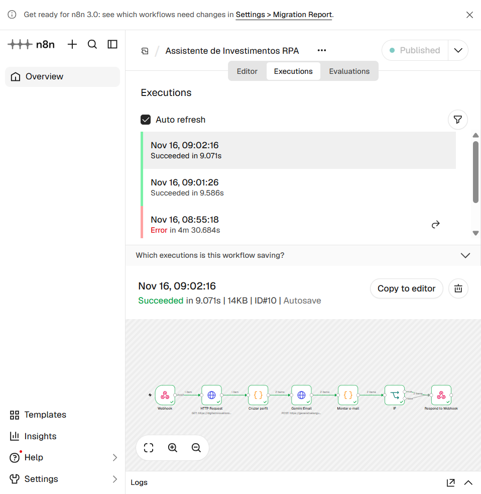

# Assistente de investimentos com RPA e n8n

Fork do lab da DIO. O Python lê a tabela de clientes, o n8n cruza com o CSV de investimentos, a Gemini monta o texto do e-mail e o Gmail envia.

Página dos clientes: https://digitalinnovationone.github.io/dio-lab-assistente-investimentos-rpa-n8n/

CSV: https://digitalinnovationone.github.io/dio-lab-assistente-investimentos-rpa-n8n/data.csv

## Fluxo

1. `rpa/extrair_clientes.py` (ou o notebook) abre a página e manda o JSON no webhook.
2. O n8n baixa o CSV e cruza perfil + saldo com o produto (Conservador, Moderado ou Arrojado).
3. A Gemini escreve o corpo do e-mail.
4. Se o texto veio preenchido, o Gmail envia.
5. O webhook responde com os dados do cliente, o produto e se o e-mail saiu.

Arquivo do fluxo: `n8n/workflow.json`

Webhook local: `http://127.0.0.1:5678/webhook/clientes`

## Como rodar

1. Subir o n8n (`n8n start`) e importar `n8n/workflow.json`.
2. Criar duas credenciais no n8n e publicar o fluxo:
   - Google Gemini (PaLM) Api
   - Gmail OAuth2 (Gmail API ligada no Google Cloud e o e-mail na lista de teste)
3. Instalar as libs e rodar o RPA:

```bash
pip install requests beautifulsoup4
python rpa/extrair_clientes.py
```

As chaves ficam só no n8n. Não vão para o repositório.

## O que eu ajustei

O cruzamento ignora maiúscula/minúscula do perfil e só indica produto cujo mínimo cabe no saldo.

O nó de agente do n8n não funcionou com a chave nova do Gemini (modelo antigo sumiu e o mais recente ficava pendurado). Chamei a API direto no HTTP Request, modelo `gemini-3.5-flash-lite`.

O Gmail usa os campos `email_to`, `assunto` e `corpo_email`. Na resposta do webhook vem `email_enviado` e o id da mensagem.

## Prints

Execução com Gemini e Gmail (todos os nós em sucesso):



Os outros prints estão em `docs/prints/`.
